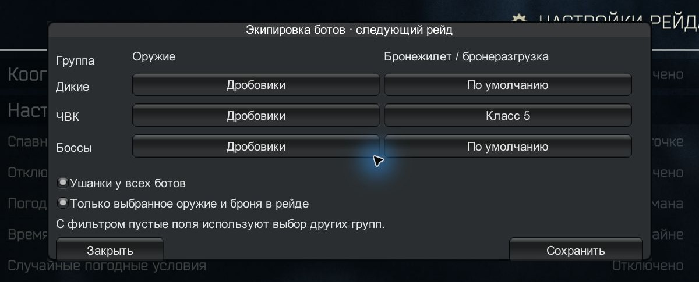

# Fast Bot Loadouts

A lightweight way to change weapons and armor for Scavs, PMCs, and bosses before a raid in SPT 4.1.6. Press **F10**, pick the gear for each group, and save. For a shotgun raid, pick **Shotguns** and an armor class for all three groups.

[Инструкция на русском](README.ru.md) · [Downloads](https://github.com/Colhiri/raid-bot-loadouts/releases/latest)

## Screenshots



[Weapon categories](docs/screenshots/weapon-categories.jpg) · [Armor classes](docs/screenshots/armor-classes.jpg) · [Scrollable model list](docs/screenshots/model-list.jpg)

## Install

1. Close the game and the SPT server.
2. Download the release ZIP and extract it beside `EscapeFromTarkov.exe`. Merge the `BepInEx` and `SPT_Runtime` folders.
3. Start the server and the game. Choose a map and continue to the raid settings screen.

This release is for **SPT 4.1.6**. It uses the client and server libraries included with SPT.

## Use

Press **F10** or click **Экипировка ботов** (Bot Loadouts). The interface uses Russian labels.

| In the menu | Meaning |
| --- | --- |
| Дикие / ЧВК / Боссы | Scavs / PMCs / Bosses |
| Категория / Класс брони / Модель | Weapon category / Armor class / Item model |
| Ушанки у всех ботов | Give all AI bots ushankas |
| Только выбранное оружие и броня в рейде | Restrict raid equipment and loot to the combined selection |
| По умолчанию / Сохранить | Default / Save |

Select a category or protection class to get a random matching model. Selected armor gets front and back plates wherever the model supports them. The front plate determines its class. The back uses the same class when compatible. The model list scrolls and accepts Russian and English search terms.

With the filter enabled, ground loot, containers, airdrops and bot inventories use the combined gear selection across the three groups. Unconfigured bots can draw from that selection. An equipment type with no selections uses standard generation. Mounted weapons and quest items are exempt. SPT handles the bot spawns.

To restore the default gear and loot for the next raid, set both fields to **По умолчанию** (Default) for every group, turn off ushankas and the raid filter, and save. With the filter on, a default field can inherit the gear selected for another group.

Select **Сохранить** (Save) before starting the raid. Settings are per profile. The client exchanges settings and catalog data with your SPT server. The mod has no external service or telemetry.

## Remove

Close the game and server and remove `BepInEx/plugins/RaidBotLoadouts` and `SPT_Runtime/user/mods/RaidBotLoadouts`. The server folder also holds the mod's saved settings.

## Build

Use the .NET 10 SDK and an SPT 4.1.6 installation.

```powershell
dotnet build Client -c Release -p:SptRoot=C:/Games/SPT-4.1.6
dotnet build Server -c Release -p:SptRoot=C:/Games/SPT-4.1.6
```

[MIT License](LICENSE)
