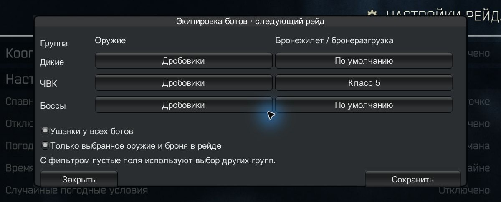

# Fast Bot Loadouts для SPT 4.1.6

Лёгкий способ поменять оружие и броню у Диких, ЧВК и боссов перед рейдом. Выберите карту, нажмите **«Далее» → F10**, задайте экипировку каждой группе и сохраните. Например, выберите **«Дробовики»** и **«Класс 4»** для всех трёх групп. Нажмите на ячейку оружия или брони нужной группы. Оружие можно выбрать по категории, бронежилет или бронеразгрузку — по классу защиты. У экипировки со сменными плитами учитывается класс передней плиты.

Вкладка **«Модель»** позволяет выбрать конкретный предмет. Список прокручивается, а поиск работает по русскому и английскому названиям. Каждое поле можно сбросить через **«По умолчанию»**.

- **Дикие** включают обычных Диких, снайперов и вариации Диких.
- **ЧВК** включает ботов USEC и BEAR.
- **Боссы** включают боссов и троих Головорезов.

Категория или класс дают случайную модель из серверных шаблонов ботов. Точки, волны и количество ботов определяет SPT.

- **Ушанки у всех ботов** заменяют головные уборы NPC и убирают несовместимые с ушанкой предметы с головы.
- **Только выбранное оружие и броня в рейде** оставляет в луте на земле, в контейнерах, в воздушных грузах и в запасах ботов всё, что подходит хотя бы одной группе. Можно указать категорию или конкретную модель оружия и класс или модель брони. Боты без своего выбора получают вариант из настроек других групп. Если оружие или броня не выбраны ни у одной группы, фильтр к этому виду экипировки не применяется. Стационарные орудия и квестовые предметы остаются на карте.

Переключатели включены по умолчанию. Нажмите **«Сохранить»** перед рейдом. Настройки хранятся отдельно для каждого профиля.

## Скриншоты



[Категории оружия](docs/screenshots/weapon-categories.jpg) · [Классы брони](docs/screenshots/armor-classes.jpg) · [Прокрутка списка моделей](docs/screenshots/model-list.jpg)

## Установка

Распакуйте архив в папку с `EscapeFromTarkov.exe`, объединив `BepInEx` и `SPT_Runtime`. Запустите сервер и игру. Клавиша настраивается в **F12 → Raid Bot Loadouts → Open loadout editor**.

## Сборка

Для сборки из корня репозитория нужны SPT 4.1.6 и .NET 10 SDK.

```powershell
dotnet build Client -c Release -p:SptRoot=C:/Games/SPT-4.1.6
dotnet build Server -c Release -p:SptRoot=C:/Games/SPT-4.1.6
```
